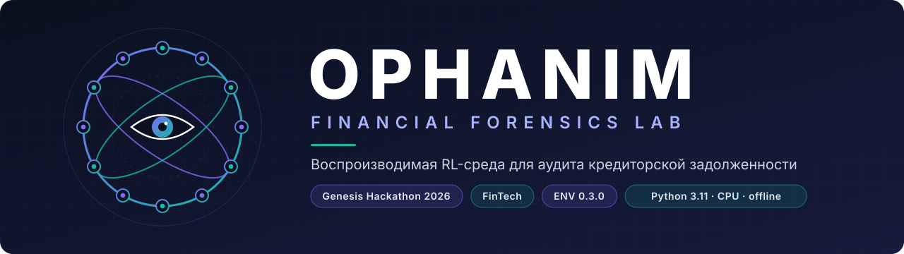
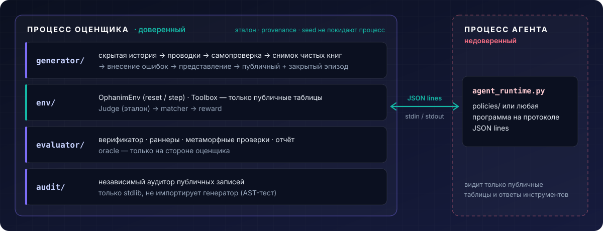
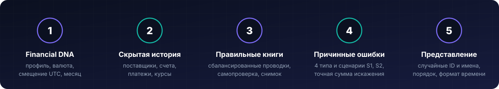
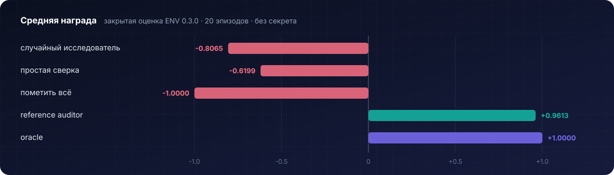

<div align="center">



<br>

<a href="#быстрый-старт"></a>
<a href="requirements.lock"></a>
<a href="#docker-без-сети-python-311-только-cpu"></a>
<a href="#воспроизводимость"></a>

<a href="LICENSE"></a>

**Воспроизводимая среда обучения с подкреплением (RL) для аудита кредиторской задолженности.**<br>
Genesis Hackathon 2026.

</div>

<br>

Агент получает учётные данные вымышленной компании за один отчётный период, исследует их через узкий
набор инструментов только для чтения и отправляет структурированные выводы с доказательствами. Среда
генерирует согласованную скрытую историю операций, вносит в неё реальные бухгалтерские ошибки через
причинные преобразования, держит эталон закрытым и оценивает выводы одним общим matcher и официальной
формулой награды.

##  Содержание

<table>
<tr>
<td valign="top">

* [Назначение](#назначение)
* [Быстрый старт](#быстрый-старт)
* [Проверка одной командой](#проверка-одной-командой)
* [Архитектура](#архитектура)
* [Генерация эпизода](#генерация-эпизода)
* [Инструменты агента](#инструменты-агента)

</td>
<td valign="top">

* [Награда и сопоставление выводов](#награда-и-сопоставление-выводов)
* [Базовые политики](#базовые-политики)
* [Траектории](#траектории)
* [Воспроизводимость](#воспроизводимость)
* [Адаптер жюри](#адаптер-жюри)
* [Где что находится](#где-что-находится)

</td>
<td valign="top">

* [Документация](#документация)
* [Ограничения](#ограничения)
* [Использование ИИ-инструментов](#использование-ии-инструментов)
* [Лицензия](#лицензия)

</td>
</tr>
</table>

##  Назначение

Задача агента - найти в книгах компании ошибки четырёх обязательных типов и доказать каждую ссылками на
записи:

| | `type` | ошибка |
|:-:|---|---|
|  | `duplicate_invoice` | один и тот же счёт поставщика учтён дважды |
|  | `payment_allocation` | платёж не распределён на счёт полностью или частично |
|  | `fx_rate` | документ пересчитан по курсу не той даты |
|  | `period_attribution` | документ отнесён не к тому отчётному периоду |

Среда отвечает за всё остальное: генерирует данные, скрывает правильный ответ, предоставляет инструменты,
изолирует агента от оценщика и считает награду. Все компании, контрагенты, документы и суммы
синтетические; реальные финансовые данные не используются.

##  Быстрый старт

### Docker (без сети, Python 3.11, только CPU)

```bash
docker build -t ophanim .
docker run --rm --network none --cpus 2 --memory 4g ophanim
docker run --rm --network none ophanim demo --seed 7                   # демонстрационный эпизод
docker run --rm --network none -e OPHANIM_EVAL_SECRET=<secret> ophanim evaluate --seed-base <hidden>
```

### Локально

```bash
python3.11 -m venv .venv && . .venv/bin/activate      # Windows: .venv\Scripts\activate
pip install -r requirements.lock                       # зафиксированные версии: pydantic 2.14.4, pytest 9.2.0
export PYTHONPATH=src                                  # Windows PowerShell: $env:PYTHONPATH="src"
python -m ophanim verify                               # тесты + данные + траектории + закрытая оценка
```

Зависимость времени выполнения одна — Pydantic. Сеть, GPU и платные API не используются.

Другие команды CLI (`python -m ophanim <команда>`):

| команда | что делает |
|---|---|
| `verify` | полная проверка репозитория (см. следующий раздел) |
| `evaluate` | закрытая оценка набора эпизодов, отчёт `report.json` и `report.md` |
| `demo --seed 7` | один эпизод, который проходит заранее написанная политика (reference auditor) |
| `generate` | сгенерировать один эпизод |
| `verify-episode <каталог>` | независимо проверить каталог эпизода |
| `build-data` | заново сгенерировать `data/train`, `data/dev` и `data/trajectories.jsonl` из `configs/` |
| `schemas` | вывести публичные JSON Schema |

##  Проверка одной командой

`python -m ophanim verify` (в Docker - `docker run` без аргументов) выполняет:

1. весь набор тестов `pytest`;
2. независимую верификацию 20 опубликованных эпизодов и их побайтную повторную генерацию из `configs/`;
3. проверку полей `data/trajectories.jsonl` и поиск утечек эталона;
4. закрытую оценку пяти политик на 20 эпизодах с проверками данных, метаморфных пар и воспроизводимости.

> [!TIP]
> Команда печатает `OPHANIM VERIFY: PASS` и завершается с кодом 0, только если пройдены все проверки.

> [!IMPORTANT]
> **Секрет в `verify` и в `evaluate`.** Закрытая оценка подписывает генерацию эпизодов ключом HMAC из
> переменной `OPHANIM_EVAL_SECRET`. Если переменная не задана:
>
> * `verify` берёт встроенное значение `ophanim-verify-local-secret` (`src/ophanim/cli.py`). Это не настоящий
>   секрет - значение открыто в коде. Оно нужно только для того, чтобы проверка прошла тот же путь генерации
>   с ключом, что и официальный закрытый прогон;
> * `evaluate` работает **без секрета** (`secret_used = false`).
>
> Ключ меняет сами эпизоды, поэтому средние награды у двух команд разные. Например, у простой сверки
> `verify` даёт -0.650, а `evaluate` без секрета -0.620. Оба набора цифр и точные команды воспроизведения
> приведены в [`docs/results.md`](docs/results.md).

##  Архитектура

Оценщик и агент работают в разных процессах. Агент видит только публичные таблицы и ответы инструментов;
эталон, provenance (история происхождения эпизода) и seed остаются в процессе оценщика.

<p align="center">
  
</p>

<details>
<summary>Та же схема в виде текста</summary>

```
 ПРОЦЕСС ОЦЕНЩИКА (доверенный)                                      ПРОЦЕСС АГЕНТА (недоверенный)
 +-------------------------------------------------------------+   +----------------------------+
 | generator/  история -> проводки -> самопроверка              |   | agent_runtime.py            |
 |             -> снимок чистых книг -> внесение ошибок         |   |   policies/ или любая       |
 |             -> представление -> публичный + закрытый эпизод  |   |   программа, говорящая на   |
 | env/        OphanimEnv(reset/step), Toolbox (только публичные |<->|   протоколе JSON lines      |
 |             таблицы), Judge (эталон) -> matcher -> reward    |   |                            |
 | evaluator/  верификатор, раннеры, метаморфные проверки, отчёт|   +----------------------------+
 | audit/      независимый аудитор (только stdlib)              |      JSON lines через stdin/stdout
 +-------------------------------------------------------------+
```

</details>

| пакет | роль |
|---|---|
| `ophanim.generator` | скрытая история, проводки, причинное внесение ошибок, представление данных |
| `ophanim.audit` | независимая сверка публичных записей; не импортирует код генератора (проверяется AST-тестом) |
| `ophanim.env` | контракт `reset`/`step`, инструменты, калькулятор, текст задачи |
| `ophanim.evaluator` | matcher, награда, судья, верификатор, oracle, раннеры, отчёт |
| `ophanim.policies` | базовые политики агента; не импортируют оценщик и генератор (проверяется AST-тестом) |
| `ophanim.adapter`, `judge_adapter.py` | точки входа для жюри |

Подробнее: [`docs/architecture.md`](docs/architecture.md), [`docs/security_model.md`](docs/security_model.md).

##  Генерация эпизода

Один эпизод - одна вымышленная компания, один календарный месяц, только кредиторская задолженность (AP).

<p align="center">
  
</p>

1. **Профиль компании («Financial DNA»).** Seed выбирает один из шести профилей (retail, trading,
   software, manufacturing, logistics, consulting), базовую валюту (десять валют, в том числе JPY с 0 и KWD
   с 3 знаками после запятой), фиксированное смещение компании от UTC (восемь вариантов) и месяц.
2. **Согласованная скрытая история.** Поставщики, счета (этого месяца и неоплаченные прошлого), платежи
   (полные, разделённые, частичные, пакетные, без расшифровки, возвраты от поставщиков) и ежедневные курсы.
3. **Правильные книги.** Движок проводок превращает документы в сбалансированные строки главной книги в
   базовой валюте, самопроверка подтверждает бухгалтерские равенства. Снимок чистых книг сохраняется в
   provenance.
4. **Причинные ошибки.** Каждая ошибка - реалистичный сбой, применённый как преобразование правильных книг.
   Для каждой проблемы фиксируются точная сумма искажения в минимальных единицах базовой валюты, затронутые
   документы, допустимые наборы доказательств и запись «до/после» в provenance.
5. **Представление.** Случайные публичные идентификаторы, имена, порядок записей и форма записи времени
   берутся из отдельного потока случайных чисел. На этом построены метаморфные проверки.

Два **взаимодействующих сценария**, в которых одна ошибка меняет правильную сумму другой:

| | сценарий | что происходит |
|:-:|---|---|
| **S1** | `fx_partial_payment_boundary` | валютный платёж у границы периода пересчитан по курсу даты UTC, и одна строка его расшифровки осталась в Suspense |
| **S2** | `fx_invoice_unapplied_payment` | валютный счёт учтён по курсу не той даты, и строка оплаты по нему не распределена |

**Ложные следы (red herrings)** - законные операции, которые внешне похожи на ошибки и встречаются и в
чистых книгах: регулярные счета с одинаковой суммой, повторные заказы, одинаковый номер счёта у разных
поставщиков, сторнированный дубль, разделённые, частичные и пакетные платежи, платежи без расшифровки,
корректные возвраты, документы, у которых дата UTC отличается от учётной даты.

Опубликованы 10 обучающих (`data/train`) и 10 отладочных (`data/dev`) эпизодов. Размеры: от 190 до 442
строк главной книги, от 88 до 205 документов. Форматы файлов и правила учёта описаны в
[`docs/data_model.md`](docs/data_model.md).

##  Инструменты агента

| действие | аргументы | результат |
|---|---|---|
| `list_records` | `table`, `cursor` (первый — `null`), `limit` не больше 50 | страница записей и курсор следующей страницы |
| `get_record` | `table`, `id` | одна запись |
| `get_document` | `doc_id` | один документ (счёт или платёж) |
| `calculator` | `expression` | точный результат арифметики в виде десятичной строки |
| `submit` | `findings` | завершает эпизод |

* Таблицы: `ledger`, `invoices`, `payments`, `fx`. Идентификаторы сравниваются точно, без приведения
  регистра и удаления пробелов.
* Калькулятор понимает только числа из цифр ASCII с десятичной точкой, `+ - * / ( )`; `eval` и вызовы
  функций не используются.
* Лимиты: 100 действий вместе с `submit` и 60 секунд на эпизод. Неизвестное действие или идентификатор
  дают ограниченную ошибку с публичным кодом и тратят шаг. `submit` даёт `terminated = true`; исчерпание
  шагов или времени — `truncated = true` с пустым ответом.

Пример на нативном интерфейсе окружения (у адаптера жюри своя оболочка действий, см. ниже):

```python
from ophanim.env import OphanimEnv

env = OphanimEnv(mode="train")
obs, info = env.reset(seed=7, config={"errors": {"duplicate_invoice": 1, "fx_rate": 1},
                                      "scenarios": {"fx_partial_payment_boundary": 1}})
episode_id = obs["manifest"]["episode_id"]
print(obs["task"], obs["manifest"], obs["policy"], obs["remaining_steps"])

obs, reward, terminated, truncated, info = env.step(
    {"action": "list_records", "table": "ledger", "cursor": None, "limit": 50})
obs, reward, terminated, truncated, info = env.step(
    {"action": "calculator", "expression": "(1250.00 * 1.083215) - 1354.02"})
obs, reward, terminated, truncated, info = env.step({"action": "submit", "findings": {
    "episode_id": episode_id,
    "findings": [{"type": "fx_rate", "affected_ids": ["INV-..."], "claimed_amount_minor": 1234,
                  "currency": "USD", "evidence_ids": ["DOC-...", "GL-...", "2026-03-14:EUR:USD"],
                  "explanation": "booked at the due-date rate"}]}})
```

##  Награда и сопоставление выводов

Награда за эпизод - официальная формула, она выдаётся в конце эпизода; каждый шаг исследования
приносит 0:

```
R = clip(2 * F1 - 1 - 0.002 * inspection_steps, -1, 1)
```

`inspection_steps` — все шаги до `submit`, включая невалидные действия; сам `submit` не считается.

Вывод засчитывается как TP, только если **точно** совпадают тип, множество `affected_ids`, сумма
`claimed_amount_minor` (допуск τ = 0 по умолчанию), валюта, а `evidence_ids` содержат хотя бы один полный
допустимый набор доказательств из существующих идентификаторов. Текст `explanation` не читается.
Сопоставление выводов с проблемами взаимно однозначное (паросочетание максимального размера); повтор
одного и того же вывода - FP.

Ошибки двух видов различаются:

> [!CAUTION]
> **Структурная ошибка** (нет обязательного поля, неверный тип значения JSON, лишнее поле, чужой
> `episode_id`, больше 30 выводов, больше 10 доказательств в выводе, объяснение длиннее 1000 символов
> Unicode) делает весь ответ невалидным: награда -1.

* **Смысловое несовпадение** (неизвестный тип, валюта в другом регистре или с пробелом, неверная сумма,
  чужие идентификаторы, недостаточные доказательства) - обычный FP или FN.

Полные правила и тесты против обхода спецификации (specification gaming):
[`docs/reward_design.md`](docs/reward_design.md).

##  Базовые политики

| политика | где | что делает |
|---|---|---|
| случайный исследователь | `policies/random_explorer.py` | случайные действия с фиксированным seed |
| простая сверка | `policies/simple_reconciliation.py` | наивные правила: тот же поставщик и сумма, суммы в Suspense, даты «как записано» |
| пометить всё | `policies/mark_everything.py` | отправляет максимум - 30 выводов: документы по очереди обвиняются во всех типах ошибок |
| oracle | `evaluator/oracle.py` | только на стороне оценщика: строит правильные выводы из закрытого эталона и отправляет обычным `submit` |
| reference auditor (дополнительно) | `policies/reference_auditor.py` | заранее написанная программа на основе независимого аудитора; пользуется только публичными данными |

Результаты закрытой оценки ENV 0.3.0 без секрета (20 эпизодов, внутреннее измерение команды, а не
результат жюри):

<p align="center">
  
</p>

| политика | средняя награда | TP | FP | FN |
|---|---:|---:|---:|---:|
| случайный исследователь | -0.8065 | 0 | 31 | 61 |
| простая сверка | -0.6199 | 35 | 247 | 26 |
| пометить всё | -1.0000 | 0 | 600 | 61 |
| reference auditor | +0.9613 | 61 | 0 | 0 |
| oracle | +1.0000 | 61 | 0 | 0 |

Reference auditor показывает, что каждый эпизод решается по доступным данным
примерно за 20 шагов. Высокая награда oracle доказывает лишь то, что оценщик способен выставить максимум.
Разбор сбоев и условия измерения: [`docs/results.md`](docs/results.md).

##  Траектории

`data/trajectories.jsonl` - 727 строк: четыре публичные политики (случайный исследователь, простая сверка,
пометить всё, reference auditor) на 10 обучающих эпизодах, в открытом режиме. Каждая строка содержит один шаг с
полями:

```
episode_id, step, action, observation, reward, terminated, truncated
```

Строка `step = 0` соответствует `reset` (`action = null`). Oracle в публичные траектории не входит. В
наблюдениях нет ни идентификаторов проблем эталона, ни данных provenance, ни seed: это проверяет
`ophanim verify`.

##  Воспроизводимость

* Генератор случайных чисел - SHA-256 в режиме счётчика с именованными подпотоками, модуль `random` не
  используется. Эталонные значения зафиксированы в тестах, набор тестов проходит на Python 3.11 и 3.14.
* Одинаковые `(seed, config, ENV_VERSION, секрет, действия)` дают одинаковые записи, наблюдения и награды.
* Опубликованные `data/train` и `data/dev` побайтно повторяются из `configs/`, в том числе в
  Linux-контейнере при данных, созданных в Windows.
* Версии зафиксированы: код - `ENV_VERSION 0.3.0` (`src/ophanim/version.py`), зависимости -
  `requirements.lock`, образ - `python:3.11.15-slim`, конфигурации наборов - `configs/`.

##  Адаптер жюри

Реализует точки входа из официальных определений проверок Genesis FinTech.

**Рабочий каталог:** корень репозитория (`/app` в Docker-образе). **Точка входа:** `judge_adapter.py` -
тонкий реэкспорт `src/ophanim/adapter.py`. Gymnasium не используется.

```python
import judge_adapter as ja

ja.generate_episode(seed, config, output_dir)        # config — конфигурация команды (см. ниже)
env = ja.make_env()
obs, info = env.reset(seed, {"mode": "closed", "episode_dir": output_dir, "team_config": {}})
obs, reward, terminated, truncated, info = env.step({"name": "list_records",
                                                     "args": {"table": "ledger", "cursor": None, "limit": 50}})
scores = ja.score_episode(output_dir, findings, inspection_steps)
```

Самопроверка: `python judge_adapter.py --smoke`. В Docker:
`docker run --rm --network none --entrypoint python ophanim judge_adapter.py --smoke`.

| точка входа | поведение |
|---|---|
| `generate_episode(seed, config, output_dir)` | Записывает `output_dir/public/{manifest.json, policy.json, ledger.csv, invoices.jsonl, payments.jsonl, fx.csv}` и `output_dir/evaluator/{truth.json, provenance.json}`. Результат детерминирован по (seed, config, версия). `config` — конфигурация команды с ключами `profile`, `size`, `errors`, `scenarios`, `distractors`, `presentation`, `allocation_mode` (см. `schemas.EpisodeConfig`); её можно передать как есть или в виде `{"team_config": {...}}`. Официальные сценарии D02 (разделённый платёж), D03 (корректный возврат) и D05 (валютный документ у границы периода) гарантированы в чистых эпизодах при `distractors` `normal` (по умолчанию) или `high`. Для D09–D11 используется `{"errors": {"payment_allocation": n}, "allocation_mode": "missing" \| "partial"}`. |
| `reset(seed, config)` или `reset(seed=..., options=config)` | `{"mode": "closed", "episode_dir": d}` загружает `d/public` в точности как сохранено: те же идентификаторы и порядок записей, без повторной генерации. Эталон не загружается, любая награда равна 0.0, в том числе при завершении. Повторный `reset` начинает тот же эпизод заново. `{"mode": "train", "episode_dir": d}` загружает `d/public` и `d/evaluator` и возвращает итоговую награду. `{"mode": "train", "team_config": {...}}` генерирует эпизод по `seed`. |
| `step({"name", "args"})` | Имена: `list_records` (`table`, `cursor`, `limit` не больше 50), `get_record` (`table`, `id`), `get_document` (`doc_id`), `calculator` (`expression`), `submit` (`findings`). Неизвестное имя или неправильная оболочка - ограниченная ошибка, которая тратит шаг. |
| `score_episode(episode_dir, findings, inspection_steps)` | Сторона оценщика. Возвращает `{tp, fp, fn, precision, recall, f1, return}`. Для структурно невалидного ответа - `return = -1`, остальные поля `null`; причина пишется в логгер `ophanim.judge_adapter`. |

**Наблюдения:**

* после `reset`: `{"task", "manifest", "policy", "remaining_steps": 100}`;
* после каждого шага: `{"result", "error", "remaining_steps"}`;
* `error` - `null` или `{"code", "message"}` с публичным кодом и фиксированным текстом.

**Результат по действиям:**

| действие | `result` |
|---|---|
| `list_records` | `{"records": [...], "next_cursor": строка или null}` |
| `get_record`, `get_document` | объект записи или документа |
| `calculator` | десятичная строка (`"0.1+0.2"` даёт `"0.3"`) |
| `submit` | `{"accepted": true}` или ошибка `invalid_submission` |

**Таблицы и идентификаторы:**

* Таблицы: `ledger`, `invoices`, `payments`, `fx`.
* Идентификаторы записей: `row_id` (главная книга), `invoice_id`, `payment_id` и ключ курса
  `"YYYY-MM-DD:SRC:TGT"` - естественный ключ, а не суррогатный идентификатор.
* Поля с идентификаторами, которые при замене нужно менять согласованно: `row_id`, `doc_id`, `invoice_id`,
  `payment_id`, `entity_id`, `invoice_refs[].invoice_id`, `refund_of` (у платежей; `null` везде, кроме
  возвратов), а в `truth.json` - `affected_ids` и `allowed_evidence_sets`.
* В `provenance.json` идентификаторы содержатся в значениях `id_map` и в таблицах `pre_mutation.tables`.

**Лимиты:**

* 100 действий вместе с `submit`; `submit` не считается шагом проверки.
* 99 действий проверки и затем `submit` - допустимо; 100 действий проверки обрывают эпизод с пустым
  ответом.
* 60 секунд на эпизод с момента `reset`.

**Типы ошибок (значения `type`):** `duplicate_invoice` - дублирование счёта; `payment_allocation` -
отсутствующее или частичное распределение платежа; `fx_rate` - неверная дата или курс пересчёта;
`period_attribution` - ошибка отнесения к отчётному периоду.

Допуск по сумме τ читается из `evaluator/truth.json` (`tolerance_minor`, то же значение продублировано в
`policy.json`). Соответствие определениям проверок отслеживается в
[`docs/research/p6_traceability_matrix.md`](docs/research/p6_traceability_matrix.md).

##  Где что находится

| требование кейса | где |
|---|---|
| 4 независимо настраиваемых типа ошибок | `src/ophanim/generator/injectors.py` |
| 2 взаимодействующих сценария | S1 и S2, `generator/history.py` и `generator/injectors.py` |
| чистые компании и ложные следы | `generator/history.py` |
| согласованная история и причинные ошибки | `generator/history.py`, `generator/posting.py` (самопроверка), снимок в provenance |
| скрытый эталон и provenance | `truth.json`, `provenance.json` - только для оценщика |
| независимая проверка | `audit/` (только stdlib, без кода генератора) и `evaluator/verifier.py` |
| контракт в стиле Gymnasium | `env/environment.py` |
| общий matcher и официальная награда | `evaluator/matcher.py`, `evaluator/reward.py` |
| 4 базовые политики | `policies/` (случайный исследователь, простая сверка, пометить всё) и `evaluator/oracle.py` |
| изоляция процессов | `agent_runtime.py`, `evaluator/process_runner.py` |
| метаморфные проверки | `evaluator/metamorphic.py` |
| 10 обучающих и 10 отладочных эпизодов | `data/train/`, `data/dev/` (из `configs/`) |
| траектории | `data/trajectories.jsonl` |
| закрытая оценка и отчёт | `evaluator/evaluation.py`, `python -m ophanim evaluate` |
| схемы JSON | `src/ophanim/schemas.py`, `python -m ophanim schemas` |
| тесты окружения, matcher и награды | `tests/` |

Каталог `artifacts/` (результаты локальных прогонов `evaluate`) исключён из Git: в нём лежат файлы только
для оценщика - траектория oracle и журнал судьи.

##  Документация

| документ | о чём |
|---|---|
| [`docs/design_note.md`](docs/design_note.md) | краткая проектная записка - **начните с неё** |
| [`docs/architecture.md`](docs/architecture.md) | компоненты, модель процессов, воспроизводимость |
| [`docs/data_model.md`](docs/data_model.md) | файлы, форматы, правила учёта, определения ошибок |
| [`docs/reward_design.md`](docs/reward_design.md) | правила matcher, награда, тесты против обхода спецификации |
| [`docs/security_model.md`](docs/security_model.md) | изоляция, угрозы, остаточные риски |
| [`docs/evaluation_protocol.md`](docs/evaluation_protocol.md) | выборки, seed, структура официальной оценки, подключение своих политик |
| [`docs/provenance_format.md`](docs/provenance_format.md) | формат `provenance.json` |
| [`docs/results.md`](docs/results.md) | измеренные результаты ENV 0.3.0 и разбор сбоев |
| [`docs/research/`](docs/research/README.md) | исследовательские материалы и отчёты о соответствии официальным проверкам |

##  Ограничения

Подробно - в разделе «Ограничения» файла [`docs/design_note.md`](docs/design_note.md). Коротко:

* только кредиторская задолженность;
* фиксированные смещения от UTC, без перехода на летнее время;
* изоляция на уровне процессов, а не песочница;
* на книгах с ошибками официальная формула не различает молчание и массовые ложные обвинения;
* reference auditor показывает, что эпизоды решаются процедурой на правилах, поэтому сложность - в
  рассуждении при ограниченном бюджете шагов, а не в скрытых фактах;
* модель не обучалась, и никаких заявлений об улучшении от обучения нет;
* все цифры в репозитории — внутренние измерения команды.

##  Использование ИИ-инструментов

В соответствии с правилами хакатона (раздел 08) команда сообщает, что код и документация(конкретно для ресерча) репозитория
разработаны с помощью ИИ-ассистента для программирования (Claude Code) под руководством и с проверкой
команды. Результаты тестов и цифры в [`docs/results.md`](docs/results.md) получены запуском кода этого
репозитория; для каждой цифры указана команда воспроизведения. Результаты предыдущей версии ENV 0.1.0
помечены там как исторические.

##  Лицензия

MIT — см. [`LICENSE`](LICENSE).

<br>

<div align="center">
<sub>Ophanim - The Apotheosis</sub>
</div>
